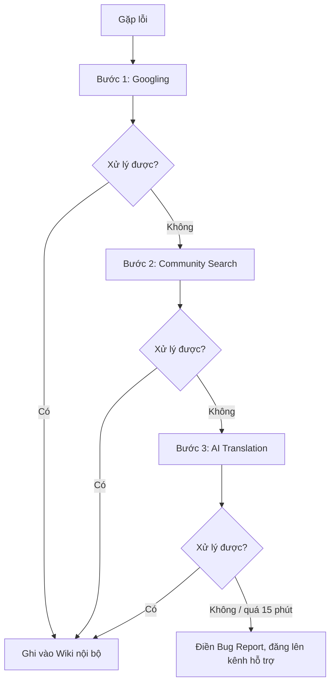

# Bài 5: Tối ưu quy trình hỗ trợ kỹ thuật nội bộ

## 1. Vấn đề
Lỗi môi trường (Docker, Port conflict) được nhắn lộn xộn vào nhóm chat, thông tin trôi mất, người sau hỏi lại lỗi cũ.

## 2. Bug Report Template (4 mảnh ghép)

```markdown
## 🐞 Bug Report

**Tiêu đề:** [Docker/Port/...] Mô tả ngắn lỗi

### 1. Context
- HĐH / phiên bản:
- Phần mềm + phiên bản:
- Đang làm gì (lệnh/bước cụ thể):
- Đã thử những gì:

### 2. Expected (mong đợi)

### 3. Actual (thực tế)

### 4. Log & Screenshot
(Dán log nguyên văn; che API Key, mật khẩu, token)

### Checklist trước khi gửi
- [ ] Đã Googling
- [ ] Đã Community Search
- [ ] Đã hỏi AI
- [ ] Đã che thông tin nhạy cảm
```

**Ví dụ (Port conflict):**

| Mảnh ghép | Nội dung |
|---|---|
| Context | Windows 11, Docker Desktop, chạy `docker compose up`; đã tra Google và StackOverflow nhưng chưa xử lý được |
| Expected | Container chạy, truy cập được `localhost:3000` |
| Actual | Container thoát ngay |
| Log | `Bind for 0.0.0.0:3000 failed: port is already allocated` |

## 3. Quy trình 3 bước tra cứu bắt buộc



1. **Googling:** bóc tách mã lỗi nguyên văn, dùng `site:`, `" "`, `-`.
2. **Community Search:** tìm Wiki/Issue nội bộ trước, rồi StackOverflow, GitHub Issues; ưu tiên câu trả lời có tích xanh, nhiều upvote, đúng HĐH/phần mềm.
3. **AI Translation:** gửi Prompt 3 thành phần (Ngữ cảnh, Lỗi nguyên văn, Yêu cầu); không gửi Secret; không chạy mù quáng lệnh AI đưa ra.

Sau tối đa **15 phút** chưa xong thì mới điền Bug Report và hỏi. Báo cáo thiếu mảnh ghép sẽ bị trả lại.

## 4. Quy tắc vận hành

- Dùng **GitHub Issues** (nhãn `docker`, `port`, `env`), mỗi lỗi một Issue, thay vì nhắn nhóm chat.
- Lỗi đã xử lý thì cập nhật cách sửa vào Wiki và đóng Issue.
- Tìm trong Wiki/Issue cũ trước khi hỏi.

## 5. Cấu trúc repository

```
├── README.md
├── .github/ISSUE_TEMPLATE/bug_report.md
└── docs/troubleshooting-wiki.md
```
